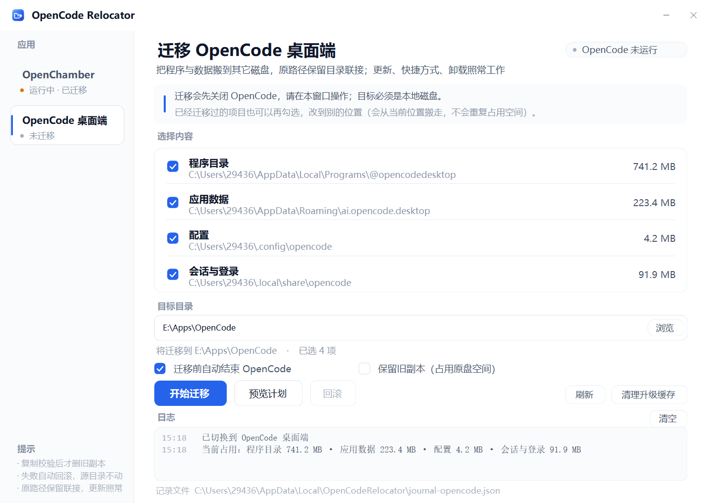
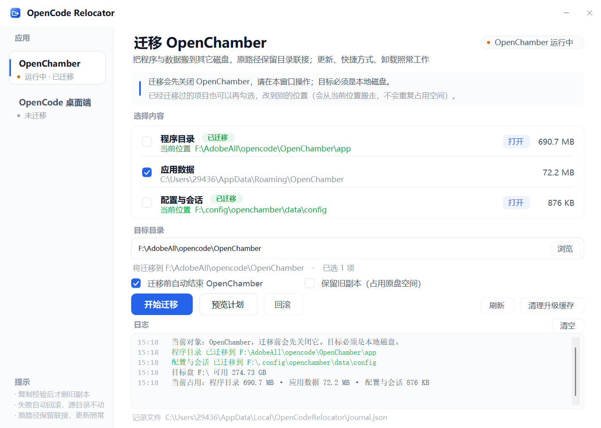

# OpenCode Relocator

> 把 **OpenCode** / **OpenChamber** 桌面端从系统盘整体搬到其它磁盘 —— 原路径保留**目录联接（junction）**，更新、快捷方式、卸载照常工作。



单文件 Windows 图形化工具，**免安装、无依赖、约 835 KB**，不需要管理员权限。

| | |
|---|---|
| 支持应用 | OpenCode 桌面端、OpenChamber |
| 系统要求 | Windows 7 及以上（Win10/11 完美），.NET Framework 4.0+（系统自带） |
| 界面语言 | 简体中文 |
| 授权 | MIT |

---

## 目录

- [为什么需要它](#为什么需要它)
- [它是怎么做的](#它是怎么做的)
- [功能一览](#功能一览)
- [会搬走哪些东西](#会搬走哪些东西)
- [快速开始](#快速开始)
- [界面说明](#界面说明)
- [安全机制](#安全机制)
- [常见问题](#常见问题)
- [已知限制](#已知限制)
- [开发者](#开发者)
- [English](#english)
- [许可证](#许可证)

---

## 为什么需要它

OpenCode / OpenChamber 这类桌面端装完就是好几 GB，程序本体在
`C:\Users\<你>\AppData\Local\Programs\...`，数据又在 Roaming 和 `.config` / `.local\share` 里，
全都在系统盘上。C 盘不够用的时候，直接剪切文件夹是**会出大问题**的：

- 快捷方式指向旧路径，程序启动不了；
- 自动更新器找不到自己的安装目录，下次更新直接失败；
- 卸载程序按注册表里的旧路径找文件，残留一堆删不掉的目录；
- 有些程序校验安装路径，发现"被搬过家"就拒绝启动。

**本工具的思路**：把数据真的搬到新盘，然后在**原来的位置留一个目录联接**。
联接在 Windows 看来就是个普通目录，里面所有路径访问都会被透明地转��到新盘。
于是程序、快捷方式、更新器、卸载器**都以为程序还在原地**，一个都不用改。

```
C:\Users\29436\AppData\Local\Programs\@opencodedesktop   ← 联接（junction）
        ↓ 透明转发
E:\Apps\OpenCode\app                                        ← 真正的文件在这里
```

## 它是怎么做的

每一项的迁移都走同一条流水线，任何一步出问题都会自动回退：

```
1. 复制      把源目录完整复制到新位置（robocopy，保留目录联接与符号链接）
2. 校验      逐个比对文件数、总字节数、链接数量——对不上就中止，源一个字都没动
3. 改名备份  把源目录改名为 <原名>.moved-<时间戳>（原路径暂时消失）
4. 建联接    在原位置建立指向新位置的目录联接
5. 二次校验  通过联接再读一遍，文件数必须一致
6. 删备份    确认无误后删除备份，原盘空间真正释放
```

第 3 步之前会先写一条 `pending` 记录进 journal：万一中途断电或被强杀，
下次打开工具仍然能从记录里找到那份备份，不会让你"数据去哪了"。

## 功能一览

- **图形界面**，左侧切换应用，右侧勾选要搬的项目、填目标目录、点「开始迁移」
- **一键回滚**：按迁移记录把数据搬回原路径，并把联接摘掉
- **支持再次迁移**：已经搬过的项目可以再勾一次，直接搬到另一个盘，不用先回滚
- **迁移计划预览**：不改动任何文件，先看看会搬什么、占多少空间
- **目录统计在后台跑**，1 GB 也不卡界面；切换应用瞬间出结果
- **运行状态每 2.5 秒自动刷新**，只认图形界面进程（后台 `opencode-cli` 不算"运行中"）
- **清理升级缓存**：一键删掉更新器留下的安装包残留
- **中文界面**，DPI 感知（125% / 150% 缩放下都不糊）

## 会搬走哪些东西

### OpenCode 桌面端

| 项目 | 原路径 | 搬到 |
|---|---|---|
| 程序目录 | `%LOCALAPPDATA%\Programs\@opencodedesktop` | `<目标>\app` |
| 应用数据 | `%APPDATA%\ai.opencode.desktop` | `<目标>\data\roaming` |
| 配置 | `%USERPROFILE%\.config\opencode` | `<目标>\data\config` |
| 会话与登录 | `%USERPROFILE%\.local\share\opencode` | `<目标>\data\share` |

### OpenChamber

| 项目 | 原路径 | 搬到 |
|---|---|---|
| 程序目录 | `%LOCALAPPDATA%\Programs\@openchamberelectron` | `<目标>\app` |
| 应用数据 | `%APPDATA%\OpenChamber` | `<目标>\data\roaming` |
| 配置与会话 | `%USERPROFILE%\.config\openchamber` | `<目标>\data\config` |

> 两个应用互相独立：记录文件分开存、互不影响，搬完一个不影响另一个。

## 快速开始

1. 从 [Releases](https://github.com/cv-superding/opencode-relocator/releases) 下载 `OpenCodeRelocator.exe`，双击运行。
2. 左侧选 **OpenCode 桌面端**。
3. 勾选要搬的项目（默认全选），把「目标目录」改成你想放的位置，例如 `E:\Apps\OpenCode`。
   - 目标必须是**本地磁盘**（固定盘或移动盘），不能是网络盘或光驱；
   - 目标卷必须是 **NTFS**（FAT32 / exFAT 建不了目录联接），工具会提前检查并拒绝。
4. 点「预览计划」确认一下，确认无误后点「开始迁移」。
5. 迁移过程中应用会被自动关闭；完成后如果它之前开着，工具会再帮你拉起来。



## 界面说明

| 区域 | 说明 |
|---|---|
| 左侧应用栏 | 切换要管理的应用，显示运行状态（运行中 / 已迁移 / 未迁移） |
| 右上角状态胶囊 | 当前应用是否在运行；后台服务不算"运行中" |
| 选择内容 | 逐项勾选，带「已迁移」标记的项会显示它的当前位置，点「打开」直接进目录 |
| 目标目录 | 要搬到哪里；可以是任意空目录 |
| 日志区 | 每一步都写在这里，迁移过程可回溯 |
| 底部页脚 | 当前应用使用的记录文件路径 |

迁移记录保存在 `%LOCALAPPDATA%\OpenCodeRelocator\`：

- `journal.json` —— OpenChamber
- `journal-opencode.json` —— OpenCode

## 安全机制

- **复制后强制校验**：文件数、总字节数、目录联接数量三者都要对得上才算通过
- **失败自动回滚**：建联接失败会把源目录原样挪回来，工具不会留下"半搬家"的状态
- **失败不留残骸**：中途失败会把刚复制出来的目标副本清掉，不占地方也不挡下次重试
- **破坏性操作前先记账**：改名之前就写好 pending 记录，断电也找得回数据
- **源目录里的联接按链接原样复制**（不跟随、不丢弃），复制后还会核对链接数量
- **空间预检**：跨盘按 1.1 倍、同盘按 2.1 倍估算（同盘时源和目标会同时存在）
- **目标占用检查**：目标目录里已经有东西就直接拒绝，不会往里乱合并
- **回滚优先用活数据**：把新位置的当前数据搬回原路径，而不是迁移当时的旧副本
- **不误杀进程**：路径读不出来的进程一律不碰，只处理能确认路径属于该应用的进程
- **原子写记录**：journal 用临时文件 + 原子替换，断电不会留下半截 JSON

## 常见问题

**搬完以后原来的路径还在吗？**
在。它现在是一个目录联接，资源管理器里看起来还是普通文件夹，双击也能进。

**快捷方式还管用吗？**
管用。快捷方式指向的是原路径，联接会透明转发过去，程序照常启动。

**自动更新会装到哪里？**
更新器写的是原路径，而原路径是联接，所以更新内容实际落到新盘——正是你想要的结果。

**卸载能卸干净吗？**
卸载程序能正常跑完并删掉它知道的东西。联接被删掉后，新盘上那份数据需要你自己再删一次
（工具的「回滚」可以帮你把它搬回原路径再处理）。

**能再搬到别的盘吗？**
能。直接勾选已经标记「已迁移」的项目，选一个新目标目录再搬一次即可：工具会从当前位置
把数据搬过去，并清掉旧位置，不会出现两份数据各占一份空间。

**搬错了怎么办？**
点「回滚」。工具按记录把数据搬回原路径、摘掉联接，并把备份副本一并清理。
回滚是逐条记录做的，某一条失败不会影响其它条目。

**需要管理员权限吗？**
不需要。目录联接（`mklink /J`）普通用户就能建，工具本身也是 `asInvoker` 运行。

**U 盘 / 移动硬盘能当目标吗？**
可以，但必须是 **NTFS** 格式；FAT32 / exFAT 建不了联接，工具会在复制之前就拒绝。

**迁移会不会影响正在跑的 `opencode-cli` 后台服务？**
不会丢数据，但迁移前工具会把它一起结束掉（它正占着 `.local\share\opencode` 里的文件）。
如果你不勾「迁移前自动结束 OpenCode」，工具会先问一句。

**为什么界面上的"运行中"和我开没开对不上？**
只统计图形界面进程。OpenCode 关了但后台 `opencode-cli` 服务还在时，界面显示"未运行"，
迁移时它仍会被结束。

## 已知限制

- 目标磁盘必须是本地卷（固定盘 / 移动盘）且为 NTFS；不支持网络盘、光驱、FAT32/exFAT
- 迁移期间会结束相关进程，包括 OpenCode 自己的后台服务
- 不处理 Windows 商店应用（MSIX / AppX）
- 源目录里如果是"目录联接"以外的特殊重解析点（例如某些加密系统的卷影副本目录），可能需要手动处理
- 目前只适配 OpenCode 与 OpenChamber 的默认安装路径；改过安装位置的请手动指定

## 开发者

### 源码结构

整个工具是一个 C# 文件，WinForms 自绘控件，不依赖任何第三方库：

| 文件 | 说明 |
|---|---|
| `OpenCodeRelocator.cs` | 全部源码：路径与迁移逻辑、界面自绘、图标、回归测试入口 |
| `bugcheck.cs` | 回归测试：沙盒内跑真实的迁移 / 回滚 / 校验逻辑 + 界面状态检查（58 项） |
| `build.ps1` | 一键编译（可选带 `-Test` 跑测试、`-Icon` 重渲染图标） |
| `app.manifest` | DPI 感知 / 免提权 / 长路径支持 |
| `icon.svg` | 图标源文件（矢量） |
| `build-icon.ps1` | 用无头 Chrome 把 SVG 渲染成各尺寸 PNG |
| `iconbuild.cs` | 把多尺寸 PNG 打包成多帧 `.ico` |

### 编译

只需要 Windows 自带的 .NET Framework 编译器，**不需要装 Visual Studio 或 .NET SDK**：

```powershell
.\build.ps1          # 编译 OpenCodeRelocator.exe
.\build.ps1 -Test    # 顺便跑全部回归测试
```

测试用的是 .NET Framework 4.0 自带的 `csc.exe`：

```
%WINDIR%\Microsoft.NET\Framework64\v4.0.30319\csc.exe
```

### 设计要点

- 迁移逻辑集中在 `Ops` 静态类里，与界面完全解耦，所以整条流水线都能在沙盒里被测试覆盖
- 目录统计、进程检测全部放后台线程，界面线程只做绘制
- 目录遍历用 Win32 `FindFirstFileW` + `\\?\` 长路径前缀，跳过重解析点以防环
- 进程路径用 `QueryFullProcessImageNameW` + `PROCESS_QUERY_LIMITED_INFORMATION`，比
  `Process.MainModule` 快得多，而且不受权限影响

## English

**OpenCode Relocator** moves the OpenCode / OpenChamber desktop installs off your system drive
by copying the files to another disk and leaving an **NTFS directory junction** at the original
location. Because the original path keeps working, updaters, shortcuts and uninstallers need no
changes at all.

- Single-file WinForms app, no installer, no dependencies, ~835 KB
- No administrator rights required
- Verified copies (file count / bytes / link count) with automatic rollback on failure
- Re-migrate to a different drive anytime, and roll back with one click
- Chinese UI

```powershell
.\build.ps1 -Test
```

## 许可证

[MIT](LICENSE) © 2026 cv-superding

> 本项目与 OpenCode、OpenChamber 官方无关，仅为其桌面端提供迁移工具。
> 两者名称与商标归各自所有者所有。
